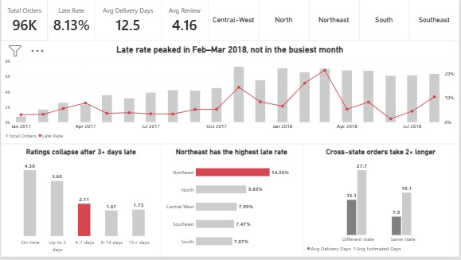

# Late Deliveries at Olist

**What makes deliveries arrive after the promised date, and does lateness lower customer ratings?**

An end-to-end analysis of about 96,000 delivered orders from Olist, a Brazilian e-commerce marketplace, using MySQL for analysis and Power BI for the dashboard.



---

## Key findings

1. **8.11% of delivered orders arrived after the estimated date** (7,826 of 96,478).
2. **Late orders hurt ratings badly.** On-time orders average **4.29** stars, late orders **2.57**. Late orders are about **7 times more likely** to get a 1-star review (46.2% vs 6.6%). They make up only about 8% of orders but **37.8% of all 1-star reviews**.
3. **Customers tolerate small delays, not long ones.** Ratings drop from 4.29 (on time) to 3.59 (up to 3 days late), then fall to **2.10 at 4–7 days late**, where the share of 1-star reviews jumps from 18% to 59%.
4. **Volume is not the main driver of lateness.** November 2017 (Black Friday) had the most orders, but the highest late rates were in **February and March 2018**. In those months, actual delivery time was the longest in the dataset while estimates stayed tight. June 2018 had high volume but the lowest late rate, because its estimates left a wide buffer.
5. **Distance matters.** 64% of orders are shipped from a seller in a different state. These cross-state orders take **twice as long** to arrive (15.1 vs 7.9 days) and are late more often (9.3% vs 6.1%), even though their estimates are already longer (27.8 vs 18.2 days).
6. **The Northeast is the most affected region** with a **14.3%** late rate, almost twice the national average. About 60% of sellers are in São Paulo state, far from the Northeast. The North has even longer delivery times (22.5 days) but a lower late rate (9.8%), which suggests its estimates are more realistic.

## Recommendation

**Set delivery estimates by route, based on recent actual delivery times between the seller's state and the customer's state, starting with cross-state orders and the Northeast.**

The problem in the Northeast is not only long delivery times but estimates that are too tight for those times. Because ratings collapse once an order is more than 3 days late, more accurate estimates on long routes should reduce 1-star reviews. Two supporting steps:

- Track average delivery time per route every month as an early warning, so estimates are adjusted when deliveries slow down (as in Feb–Mar 2018).
- Investigate the cause of the Feb–Mar 2018 slowdown with the operations team. The data shows it happened, but not why.

Estimates should be accurate, not simply longer: a very long estimate can also discourage customers from buying.

---

## Data

- **Source:** [Brazilian E-Commerce Public Dataset by Olist](https://www.kaggle.com/datasets/olistbr/brazilian-ecommerce) (Kaggle)
- **Tables used:** orders, order_reviews, customers, order_items, sellers
- **Period:** September 2016 – October 2018. Trend analysis and the dashboard use **January 2017 – August 2018**, because the months outside that range are incomplete.
- **Definition of late:** the order reached the customer after `order_estimated_delivery_date`. Only orders with status `delivered` are included.

## Approach

| Stage | What I did | File |
|---|---|---|
| 1. Import | Created tables and loaded the CSV files into MySQL, validating every row count | [`01_data_import.sql`](sql/01_data_import.sql) |
| 2. Exploration | Order volume, overall and monthly late rate, estimated vs actual delivery time | [`02_exploration.sql`](sql/02_exploration.sql) |
| 3. Joins | Late vs on-time ratings, late rate per state, data checks on reviews and customers | [`03_reviews_and_states.sql`](sql/03_reviews_and_states.sql) |
| 4. Deeper analysis | Cross-state shipping, regions, delay severity, monthly change (LAG), state ranking (RANK) | [`04_distance_severity_trends.sql`](sql/04_distance_severity_trends.sql) |
| 5. Dashboard | Built a one-row-per-order dataset and a Power BI dashboard with DAX measures | [`05_dashboard_dataset.sql`](sql/05_dashboard_dataset.sql) |

**SQL techniques:** JOINs across four tables, CASE WHEN, conditional aggregation, date functions, HAVING, CTEs, window functions (LAG, RANK with PARTITION BY).
**Power BI:** Power Query type and locale fixes, DAX measures (DIVIDE, COUNTROWS), calculated columns with SWITCH, custom sort order, slicers.

## Data quality notes

- **Missing review on import:** the first import of the reviews table returned 99,223 rows instead of 99,224. A backslash in one customer comment caused two reviews to merge into one row. Fixed with `ESCAPED BY ''` and re-validated.
- **Duplicate import:** the order_items table was accidentally loaded twice (225,300 rows, exactly double). Caught by checking the row count against the expected 112,650 and reloaded.
- **Multiple reviews per order:** 551 reviews (0.56%) belong to orders that already have a review, for example customers who re-reviewed after items arrived separately. The impact is small, so all reviews were kept in SQL. The dashboard uses the average score per order.
- **Small states:** states with 100 orders or fewer were excluded from state-level comparisons, because a single late order shifts their late rate by several points.
- **Correlation, not causation:** the data shows that late orders are linked to much lower ratings. It does not prove lateness is the only cause, since other factors (such as product quality from the same sellers) may also play a role.

## Repository structure

```
olist-late-delivery-analysis/
├── README.md
├── sql/
│   ├── 01_data_import.sql
│   ├── 02_exploration.sql
│   ├── 03_reviews_and_states.sql
│   ├── 04_distance_severity_trends.sql
│   └── 05_dashboard_dataset.sql
├── dashboard/
│   └── olist_late_delivery_dashboard.pdf
└── images/
    └── dashboard.png
```

The raw CSV files are not included. Download them from Kaggle using the link above.

---

**M Fariel Fahriza Tielung (Ariel)** · Mathematics graduate, Universitas Padjadjaran
